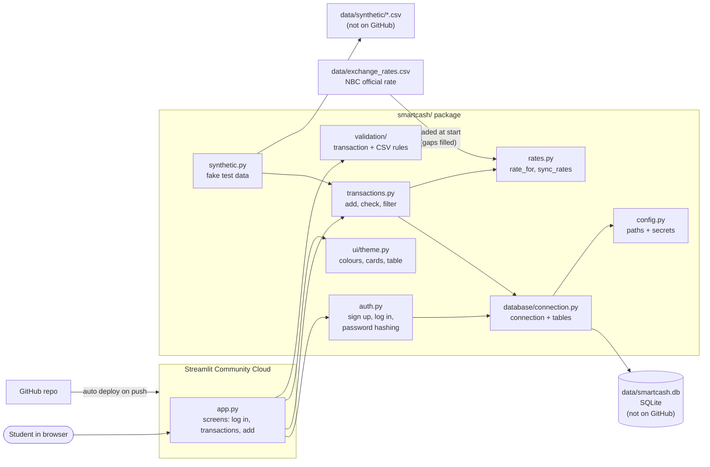

# SmartCash architecture (current system)

Only what exists **today**. We add boxes when new parts are built
(for example PostgreSQL in SCG-35).

**How data moves**
- The student logs in. `auth.py` checks the password hash. The password itself is never saved.
- `app.py` never writes SQL. It calls `auth.py` and `transactions.py`.
- Every transaction function needs the `user_id`, so a user only sees their own rows.
- `rates.py` turns KHR into USD with the official rate of that day.
- `config.py` keeps all file paths and reads secrets from the environment or Streamlit secrets.
- `database/connection.py` owns SQLite connection setup and table creation.
- `validation/` contains reusable transaction and CSV input rules.
- A push to GitHub updates the live app on Streamlit Cloud.
