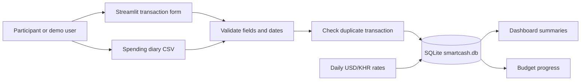
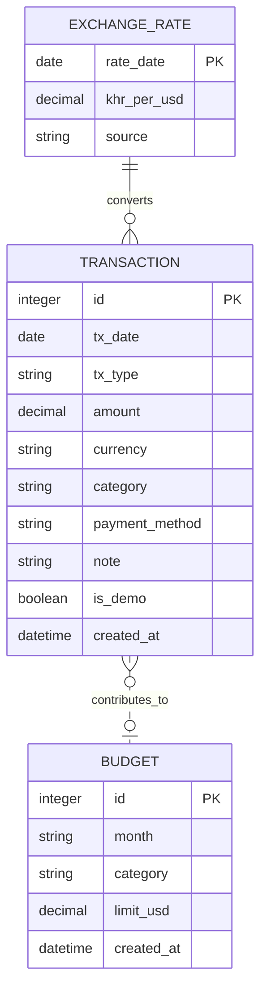

# SmartCash architecture

## Sprint 2 system flow

The application accepts transactions through the Streamlit form or a CSV diary.
Both inputs use the same validation and duplicate-checking path before data is
stored in SQLite. Dashboard and budget views read the stored transactions and
convert KHR values to USD using the applicable daily exchange rate.

## Database diagram

The Sprint 2 SQLite schema contains transactions, exchange rates, and budgets.
The transaction table stores only the fields needed for the diary and uses
`is_demo` to keep synthetic records distinguishable from approved project data.

`BUDGET` is a logical application entity for the budget page. The current
budget view keeps its draft budget values in Streamlit session state; a later
sprint can persist this table in SQLite without changing the user flow.

The working Sprint 2 implementation is intentionally small: `app.py`
provides the Streamlit screens, `db.py` provides the SQLite data layer, and
`smartcash/ui/theme.py` contains shared visual styling. Future database,
analytics, chart, and validation code should be added only when it is used by
the application.

## Data rules

- Every transaction has a date, type, amount, currency, category, payment
  method, and optional note.
- KHR is converted with the rate on the transaction date, or the latest
  earlier rate when that date has no entry.
- CSV imports report imported, duplicate, and rejected rows.
- Synthetic records are marked with `is_demo = 1` and can be removed safely.
