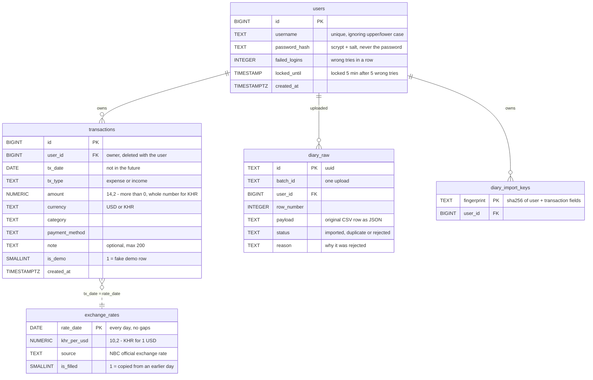

# SmartCash database (current tables)

The tables that exist **today** in the hosted PostgreSQL database (SCG-35).
They are created by `migrations/001_core_tables.sql` and `migrations/002_diary_import.sql`.
Local development uses the same tables in SQLite (`data/smartcash.db`).
We grow this diagram when a new migration adds a table.

**Notes**
- Every table with user data has `user_id`; deleting a user deletes their rows (`ON DELETE CASCADE`).
- The rate link is by date only. It is not a foreign key.
- `schema_migrations` (not drawn) lists which migration files already ran.
- No table has real names, emails, phone numbers or account numbers (SCG-68).
