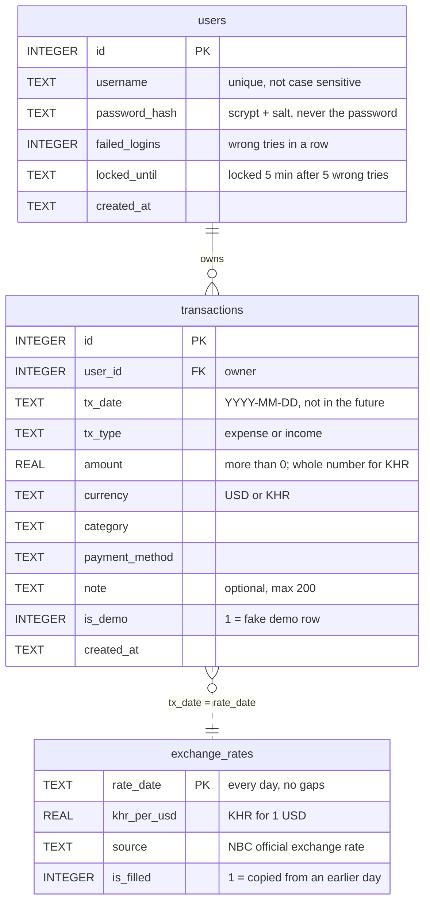

# SmartCash database (current tables)

Only the tables that exist **today** in `data/smartcash.db` (SQLite).
We grow this diagram when new tables are added (SCG-35 PostgreSQL schema).

**Notes**
- `transactions.user_id` → `users.id`. Deleting a user deletes their transactions.
- The rate link is by date only. It is not a foreign key.
- No table has real names, emails, phone numbers or account numbers (SCG-68).
